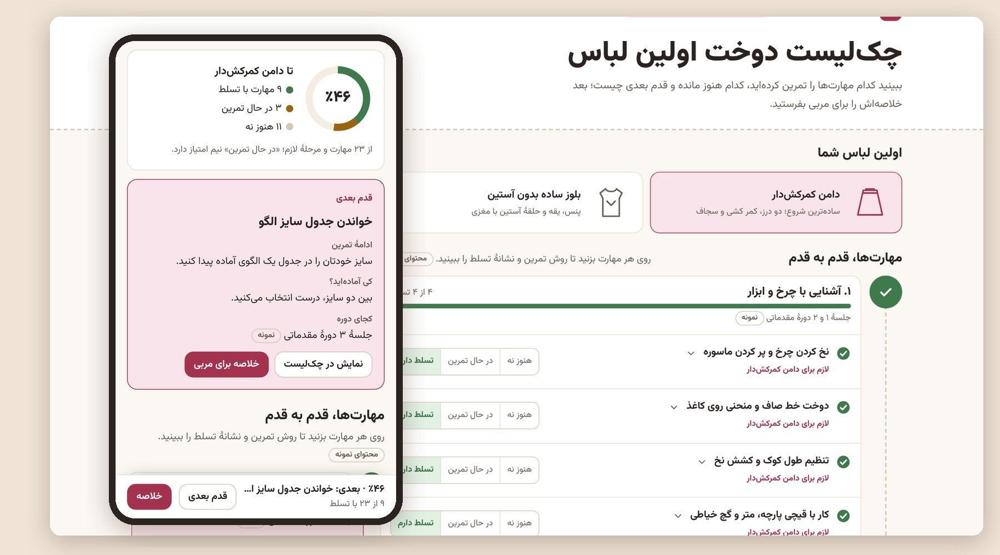

<div align="center">
  <h1>First Garment Sewing Checklist Demo</h1>
  <p><b>A Persian, right-to-left, phone-first web demo: a sewing student picks a first garment, marks each skill as not yet, practising or mastered, and sees overall progress, the next step and a short summary to send to the teacher.</b></p>
  <p>Proposal demo by <b>DARIUSH Digital Studio</b> for <b>Madar Art School</b> (آموزشگاه هنر مادر) · skills and sessions are sample content</p>
  <p>
    <a href="https://dariush-tech.github.io/madar-sewing-checklist/"><b>Live demo</b></a> ·
    <a href="#demo-flow">Demo flow</a> ·
    <a href="#editing-the-checklist">Editing the checklist</a> ·
    <a href="#run-locally">Run locally</a>
  </p>
  <p>
    
    
    
    
    
  </p>
  
</div>

<div dir="rtl">

### خلاصه

دموی پیشنهادی DARIUSH Digital Studio برای آموزشگاه هنر مادر. هنرجو اولین لباسش را انتخاب می‌کند (دامن کمرکش‌دار، بلوز ساده بدون آستین یا شلوار راحتی) و مهارت‌های لازم برای همان لباس در شش مرحله نمایش داده می‌شود: آشنایی با چرخ و ابزار، پارچه و اندازه‌گیری، الگو و برش، درز و تمیزدوزی، جزئیات لباس و مراحل دوخت خود لباس. برای هر مهارت سه وضعیت «هنوز نه»، «در حال تمرین» و «تسلط دارم» هست و با باز کردن آن، «چطور تمرین کنم» و «نشانهٔ تسلط» دیده می‌شود. درصد پیشرفت، شمار مهارت‌ها و کارت «قدم بعدی» همیشه در دسترس است و «خلاصه برای مربی» پیشرفت، مهارت‌های در حال تمرین، قدم بعدی و یک سؤال اختیاری را برای کپی در پیام‌رسان آماده می‌کند. «امتحان با هنرجوی نمونه» با یک کلیک هنرجویی را نشان می‌دهد که ابزار و پارچه را بلد است و وسط الگو و برش است.

</div>

## Demo flow

1. **Try the sample student.** «امتحان با هنرجوی نمونه» loads a student making the elastic-waist skirt: tools and fabric mastered, pattern work in progress. Progress shows 46% and the next step, reading a size chart, opens in the list.
2. **Choose the first garment.** Skirt, sleeveless blouse or lounge pants. The required skills change with the garment: darts and bias binding for the blouse, curved seams for the blouse and pants, an elastic waist for the skirt and pants. Skills that are not needed are marked optional and do not count.
3. **Mark each skill.** Three states per skill; «در حال تمرین» counts as half. Opening a skill shows how to practise it and the sign of mastery. Arrow keys move between the three states.
4. **Progress and next step.** A ring with mastered, practising and not-yet counts, a bar per stage, and a next-step card with what to practise, when it counts as mastered and where it sits in the course. On phones a slim bar keeps the percentage and next step in reach.
5. **Summary for the teacher.** Garment, overall and per-stage progress, skills in practice, the next step and an optional question, shown exactly as it will be copied.

## Editing the checklist

All content lives at the top of the script, with Persian comments:

- `GARMENTS`: the first garments, each with its own sewing steps.
- `STAGES`: the skill stages and their skills. Each skill has a title, how to practise it and the sign of mastery. `need` lists the garments that require it; leave it out to require it for every garment, or set it to `[]` to make it optional.
- `SAMPLE`: the sample student's garment and skill states.

Session labels such as «جلسهٔ ۳ دورهٔ مقدماتی» are marked «نمونه» on the page until the school replaces them with its own syllabus.

## Notes

- No account, phone number or payment. The summary is built in the browser and nothing is sent automatically.
- Progress is kept in `localStorage`; «بازنشانی دمو» clears it after a confirmation.
- Works opened straight from disk or on GitHub Pages, in light and dark themes.

## Project structure

```
madar-sewing-checklist/
├── index.html   # markup, styles, checklist content and scripts (single file, no build step)
└── docs/        # README media
```

## Run locally

```bash
git clone https://github.com/dariush-tech/madar-sewing-checklist.git
cd madar-sewing-checklist
python3 -m http.server 8000
# open http://localhost:8000, or open index.html directly
```

---

Design & development: [Dariush Technology](https://github.com/dariush-tech) · DARIUSH Digital Studio
